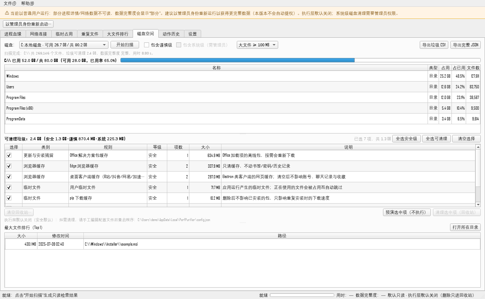

# Perf Purifier

**Windows local system inspector & safe cleaner — read-only by default.**

[](https://github.com/Mgnaer/perf-purifier/actions/workflows/ci.yml)
[](LICENSE)
[](https://www.python.org/)
[](#requirements)

Perf Purifier (性能与净化) is a Windows 10/11 toolkit that scans your machine and — only when you
explicitly enable it — cleans up **through the Recycle Bin**. It ships both a PySide6 desktop GUI
and a command-line interface built on the same core.

> **Not an antivirus.** Risk markings come from heuristics and can be wrong.
> Perf Purifier does not prove a file or process is malicious, and it is not a substitute for
> endpoint security software.



*Module C — “磁盘空间” page: drive overview, junk-rule table with checkboxes, preview and
Recycle-Bin-only cleanup. Screenshot uses demo data; the execution layer is off by default.*

---

## Safety model (read this first)

The execution layer (anything that writes to disk or terminates a process) is **off by default**.
The defaults, and what every destructive action must respect:

| Guarantee | How it is enforced |
|---|---|
| Read-only by default | Scanning pages/tabs never modify anything; scanning and export need no switches |
| Recycle Bin only | Deletion goes through `send2trash`; a failure is reported and **never** falls back to permanent delete |
| Explicit opt-in | `stage2_enabled` + one per-action switch in `config.json` must be edited manually, then the app restarted |
| Preview → confirm | First real use of an action requires a dry run; each run requires target selection + a confirmation dialog |
| Re-validate before acting | Every target is re-checked right before the action: presence, size/mtime identity, reparse point, allowed root, protected path, user-data area |
| Protected paths | WinSxS, `System32\config`, drivers, WindowsApps, `$Recycle.Bin`, System Volume Information, Boot/EFI/Recovery, user documents/desktop/downloads — never touched |
| No reparse points | Junctions/symlinks are skipped during scans and refused during actions (no cross-volume surprises) |
| No network, no auto-elevation | No telemetry, no uploads, no automatic UAC prompt; admin restart is an explicit button |
| Audited | Every action item is appended to `%LOCALAPPDATA%\PerfPurifier\logs\operations.jsonl` |

---

## Features

### Module A — process / network / temp (read-only + opt-in actions)
- Process lineage tree with heuristic risk scoring, parent/child anomalies, PID-reuse detection
- Digital signature verification (`WinVerifyTrust`, no online revocation checks)
- Network connections mapped to processes, classified public/private/internal, "needs review" flags
- Temp usage aggregation (`%TEMP%`, Windows Temp, known caches) with occupancy probing
- Opt-in: delete temp files to the Recycle Bin, terminate processes (typed confirmation phrase)

### Module B — duplicate / large files
- Size → 4 KB fingerprint → full SHA-256 pipeline, hard-link aware, SQLite hash cache
- Duplicate groups with side-by-side comparison and a "suggested keep" heuristic
- Large-file ranking; CSV / JSON / self-contained HTML export
- Opt-in: hard-link de-duplication and hard-link detachment (same-volume NTFS, rehash before action)

### Module C — disk space (new in 1.2.0)
- **Overview**: drive usage + top-level directory breakdown + largest files (single traversal)
- **Junk rules**: 34 declarative rules in three risk tiers — *safe*, *caution*, *system*
  - temp files, app updater caches, browser/Electron client caches, game shader caches,
    launcher caches, crash dumps, thumbnails, Windows Update/logs/dumps, Defender old platforms,
    recycle bin
- **Safe cleanup**: preview → select rules → confirm → Recycle Bin → audit log
- **Empty Recycle Bin** as a separate, typed-phrase-confirmed action
- Export junk list CSV / full JSON

See [docs/10-磁盘空间模块.md](docs/10-磁盘空间模块.md) (Chinese) for the design and rule table,
and the [CLI section](#command-line-interface) below.

---

## Requirements

- Windows 10 or Windows 11, 64-bit
- Python 3.10+ (only when running from source)
- No admin rights needed for read-only scanning or user-level cleanup;
  admin is required for *system*-tier rules (Windows Update cache, system logs, …)

## Installation & run

### Option A — prebuilt release (recommended)

Download from [Releases](https://github.com/Mgnaer/perf-purifier/releases):

- `PerfPurifier-<tag>-windows-x64.zip` → extract → run `PerfPurifier.exe`
- `perfpurifier-cli.exe` → standalone CLI

The binaries are unsigned; Windows SmartScreen may warn on first run
(*More info → Run anyway*).

### Option B — run from source

```powershell
git clone https://github.com/Mgnaer/perf-purifier.git
cd perf-purifier
python -m venv .venv
.\.venv\Scripts\python.exe -m pip install -r requirements.txt

# GUI
.\.venv\Scripts\python.exe run.py

# CLI
.\.venv\Scripts\python.exe run_cli.py scan
```

---

## Command-line interface

`perfpurifier-cli` (or `python run_cli.py`) exposes the same engine with no GUI:

```text
overview   space overview: drives, top-level usage, largest files
scan       junk-rule scan (read-only)
clean      preview / execute cleanup (preview by default; --apply to run)
large      largest files (read-only)
history    action audit history (read-only)
rules      rule library (read-only)
config     config and log paths (read-only)
menu       interactive menu (also shown when started without arguments)
```

```powershell
perfpurifier-cli overview
perfpurifier-cli scan
perfpurifier-cli clean                                   # preview only
perfpurifier-cli clean --apply --yes --empty-trash       # recycle + empty bin (frees space)
perfpurifier-cli clean --apply --caution                 # include caution tier
perfpurifier-cli clean --apply --caution --system        # + system tier (admin terminal)
perfpurifier-cli clean --apply --only temp_user,edge_cache --skip recycle_bin
perfpurifier-cli large --min-size 500MB --top 50
perfpurifier-cli scan --json report.json
```

Exit codes: `0` success, `2` failure, `130` interrupted. Without `--apply` nothing is deleted.
The CLI moves files to the Recycle Bin only; it has no permanent-delete path.

---

## Enabling the execution layer (GUI)

All destructive actions are disabled by default. To enable them:

1. Open `%LOCALAPPDATA%\PerfPurifier\config.json` (the Settings page shows the exact path)
   and set, for example:

   ```json
   {
     "stage2_enabled": true,
     "allow_clean_space": true
   }
   ```

2. Restart the application.
3. On first use of an action, click **预演选中项 (dry run)** once.
4. Then select targets, click the action button, and confirm.

The Settings page can only **turn switches off** (one click disables everything); it never
turns them on — enabling always requires editing the file, which keeps a deliberate friction.

### config.json overview

| Key | Default | Meaning |
|---|---|---|
| `stage2_enabled` | `false` | Master switch for every destructive action |
| `allow_delete_temp` | `false` | Module A: delete temp files to Recycle Bin |
| `allow_hardlink_dedupe` | `false` | Module B: hard-link de-duplication |
| `allow_kill_process` | `false` | Module A: terminate processes (typed phrase required) |
| `allow_clean_space` | `false` | Module C: disk space junk cleanup |
| `action_max_clean_items` | `500` | Module C per-run item limit |
| `action_max_clean_bytes` | `10737418240` | Module C per-run byte limit (10 GiB) |
| `slim_include_caution` / `slim_include_system` | `false` | Remembered scan-scope toggles |
| `slim_exclude_paths` | `[]` | Extra paths never cleaned by Module C |
| `file_scan_exclude_patterns` | `[]` | Module B scan excludes |
| `analysis_whitelist_paths` / `analysis_whitelist_names` | `[]` | Suppress heuristic false positives |

The authoritative list with every budget knob lives in
[`core/config.py`](src/perf_purifier/core/config.py); a commented table is in
[README_zh.md](README_zh.md#可调参数).

---

## Data locations

| What | Path |
|---|---|
| Config & logs | `%LOCALAPPDATA%\PerfPurifier\` |
| Action audit log (JSONL, rotated) | `%LOCALAPPDATA%\PerfPurifier\logs\operations.jsonl` |
| Run log (rotated) | `%LOCALAPPDATA%\PerfPurifier\logs\run.log` |
| Default export folder | Desktop `PerfPurifier报告\` |

---

## Project layout

```text
perf-purifier/
├─ run.py                 GUI entry point
├─ run_cli.py             CLI entry point
├─ src/perf_purifier/
│  ├─ app.py              application startup, logging, disclaimer
│  ├─ cli.py              command-line interface
│  ├─ core/               models, config, action policy, audit, trash, winapi, console, …
│  ├─ module_a/           process snapshot / tree / signatures / network / temp
│  ├─ module_b/           directory walk, hashing pipeline, duplicates, hard links
│  ├─ module_c/           disk space: rules, scanner, policy, executor, report
│  ├─ jobs/               QThread scan/action jobs
│  ├─ exporters/          CSV / JSON / HTML primitives
│  └─ ui/                 main window, pages, dialogs, models, widgets
├─ tests/                 pytest suite (unit + headless UI + CLI)
├─ docs/                  design & safety documents (Chinese)
├─ scripts/               env setup, release build, smoke scripts
└─ .github/               CI, release workflow, issue/PR templates, Dependabot
```

## Testing

```powershell
.\.venv\Scripts\python.exe -m pip install -r requirements-dev.txt
$env:QT_QPA_PLATFORM = "offscreen"     # required for headless UI tests
.\.venv\Scripts\python.exe -m pytest -q
.\.venv\Scripts\python.exe -m ruff check src tests
```

The full suite runs offline (no network) and never touches the real Recycle Bin: tests inject a
recording trash backend.

## Limitations

- Windows 10/11 64-bit only; the GUI uses Qt (PySide6).
- Heuristics are not a security verdict; "needs review" is a hint, not a conclusion.
- Non-admin runs show partial data ("数据完整度：部分") — expected.
- Reparse points / cloud placeholders / `$Recycle.Bin` / System Volume Information are skipped.
- Recycle-Bin deletion does not free disk space until the bin is emptied
  (`clean --empty-trash` or the GUI button does it explicitly).
- Unsigned binaries → SmartScreen warning on first run.

## Contributing & security

- [CONTRIBUTING.md](CONTRIBUTING.md) — setup, tests, style, safety red lines
- [SECURITY.md](SECURITY.md) — security model and private vulnerability reporting
- [CODE_OF_CONDUCT.md](CODE_OF_CONDUCT.md) — Contributor Covenant 2.1
- [RELEASING.md](RELEASING.md) — how to publish this repository and cut a release

## License

[MIT](LICENSE) © Perf Purifier contributors

---

中文说明：[README_zh.md](README_zh.md)
