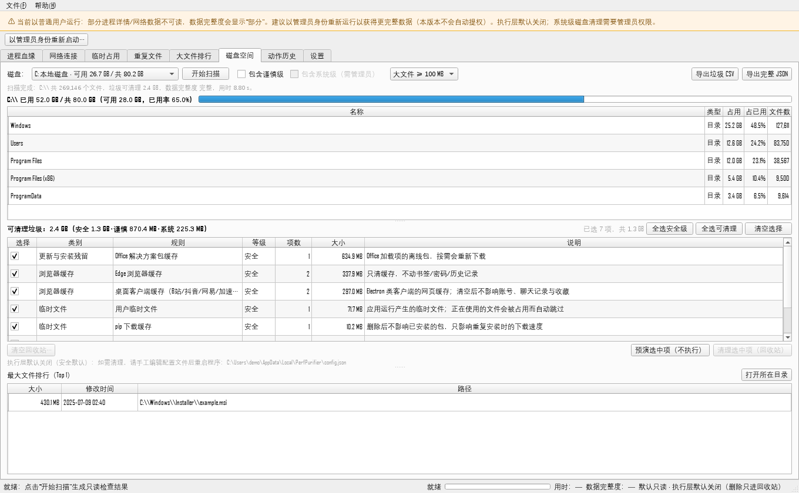

# 性能与净化（Perf Purifier）

**Windows 本地系统检查与安全清理工具 —— 默认只读。**

[English README](README.md) ｜ [CHANGELOG](CHANGELOG.md) ｜ [发布指南](RELEASING.md)

性能与净化扫描本机运行状况（进程血缘、网络连接、临时占用、重复/大文件、磁盘空间），
并**仅在你显式开启后**通过回收站清理。提供 PySide6 桌面版与命令行版（同一套核心）。

> **这不是杀毒软件。** 风险标记来自启发式规则，可能误报，不构成安全结论。



*模块 C「磁盘空间」页：空间概览 + 可勾选垃圾规则表 + 预演 + 只进回收站的清理。
截图使用演示数据；执行层默认关闭。*

---

## 安全边界（先读这一段）

执行层（写磁盘 / 结束进程）**默认关闭**，且必须满足以下全部约束：

| 保证 | 实现方式 |
|---|---|
| 默认只读 | 所有页面只读；扫描与导出不需要任何开关 |
| 只进回收站 | 删除统一走 `send2trash`；失败只报告，**绝不**回退永久删除 |
| 显式开启 | 必须手工编辑 `config.json` 的 `stage2_enabled` + 对应动作开关，然后重启程序 |
| 预演 → 确认 | 首次真实动作前必须完成一次预演；每次执行需勾选目标 + 二次确认 |
| 执行前重验 | 逐项重验：存在性、大小/mtime 身份、重解析点、规则根归属、受保护路径、用户数据区 |
| 受保护路径 | WinSxS、`System32\config`、drivers、WindowsApps、`$Recycle.Bin`、System Volume Information、Boot/EFI/Recovery、桌面/文档/下载 —— 永不触碰 |
| 不跟随链接 | 扫描跳过符号链接/junction，执行时一律拒绝（不会跨盘误删） |
| 不联网、不自动提权 | 无遥测、无上传；管理员重启是显式按钮（UAC 由系统控制） |
| 全量审计 | 每个动作写入 `%LOCALAPPDATA%\PerfPurifier\logs\operations.jsonl` |

---

## 功能

### 模块 A —— 进程 / 网络 / 临时占用（只读 + 可选动作）
- 进程血缘树 + 启发式风险评分、异常父子关系、PID 复用识别
- 数字签名校验（WinVerifyTrust，不做在线吊销查询）
- 网络连接关联进程并分类（公网/内网/内核），标记"需人工核实"
- 临时占用聚合（`%TEMP%`、Windows Temp、已知缓存目录）+ 只读占用探测
- 可选动作：删除 Temp 到回收站、结束进程（需输入确认词）

### 模块 B —— 重复文件 / 大文件
- 大小分桶 → 4KB 指纹 → 完整 SHA-256，识别硬链接，SQLite 哈希缓存
- 重复组双栏对比 + "建议保留"启发式
- 大文件排行；CSV / JSON / 自包含 HTML 报告
- 可选动作：硬链接去重、硬链接独立化（同卷 NTFS，执行前重算哈希）

### 模块 C —— 磁盘空间（1.2.0 新增）
- **空间概览**：分区用量 + 卷根顶层目录占用 + 最大文件（单遍遍历，一次扫描全出）
- **垃圾规则**：34 条声明式规则，分三档风险 —— *安全 / 谨慎 / 系统*
  - 用户临时文件、应用更新包缓存、浏览器与 Electron 客户端缓存、游戏着色器缓存、
    启动器缓存、崩溃转储、缩略图、Windows 更新/日志/内存转储、Defender 旧平台、回收站
- **安全清理**：预演 → 勾选规则 → 二次确认 → 移入回收站 → 写审计日志
- **清空回收站**：独立动作，需输入确认词
- 导出垃圾明细 CSV / 完整 JSON

设计细节与规则表见 [docs/10-磁盘空间模块.md](docs/10-磁盘空间模块.md)。

---

## 环境要求

- Windows 10 / 11（64 位）
- 仅源码运行时需要 Python 3.10+
- 只读扫描与用户级清理**不需要管理员权限**；系统级规则（Windows 更新缓存、系统日志等）需要管理员终端

## 安装与运行

### 方式 A —— 下载发布包（推荐）

从 [Releases](https://github.com/Mgnaer/perf-purifier/releases) 下载：

- `PerfPurifier-<tag>-windows-x64.zip` → 解压 → 运行 `PerfPurifier.exe`
- `perfpurifier-cli.exe` → 独立命令行版

未签名程序首次运行可能出现 SmartScreen 提示（更多信息 → 仍要运行）。

### 方式 B —— 源码运行

```powershell
git clone https://github.com/Mgnaer/perf-purifier.git
cd perf-purifier
powershell -ExecutionPolicy Bypass -File scripts\setup_env.ps1   # 建 .venv 并装依赖
.\.venv\Scripts\python.exe run.py                                # GUI
.\.venv\Scripts\python.exe run_cli.py scan                       # CLI
```

---

## 界面（GUI 八个页签）

1. **进程血缘**：进程树 + 详情 + 风险证据 + 签名状态；
2. **网络连接**：连接列表 + 分类筛选 + 搜索 + 导出 CSV；
3. **临时占用**：目录汇总 + 条目表 + 占用状态 + 导出；
4. **重复文件**：选目录 → 扫描 → 重复组/文件/双栏对比 → 多种导出；
5. **大文件排行**：Top N + 打开所在目录 + 导出；
6. **磁盘空间**（新）：概览 + 垃圾规则（可勾选）+ 预演 + 清理 + 清空回收站 + 导出；
7. **动作历史**：只读解析审计日志，筛选/分页/坏行容错；
8. **设置**：运行信息 + 执行层开关（只读，可一键关闭全部）+ 白名单/排除规则 + 完整配置。

## 命令行（CLI）

```text
overview   空间盘点（分区 / 顶层占用 / 大文件）
scan       垃圾规则扫描（只读）
clean      预演 / 执行清理（默认预演，--apply 才执行）
large      大文件排行（只读）
history    动作审计历史（只读）
rules      规则库（只读）
config     配置与日志路径（只读）
menu       交互式主菜单（无参数启动时自动进入）
```

```powershell
perfpurifier-cli overview
perfpurifier-cli scan
perfpurifier-cli clean                                  # 只预演，不删除
perfpurifier-cli clean --apply --yes --empty-trash      # 清理并立即清空回收站
perfpurifier-cli clean --apply --caution                # 含谨慎级
perfpurifier-cli clean --apply --caution --system       # 含系统级（需管理员）
perfpurifier-cli clean --apply --only temp_user --skip recycle_bin
perfpurifier-cli large --min-size 500MB --top 50
perfpurifier-cli scan --json report.json
```

退出码：`0` 成功、`2` 失败、`130` 中断。**不带 `--apply` 时不会删除任何东西**；
CLI 也只有"移动到回收站"一条删除路径，没有永久删除。

---

## 开启执行层（GUI）

所有破坏性动作默认关闭。开启步骤：

1. 打开 `%LOCALAPPDATA%\PerfPurifier\config.json`（设置页显示确切路径），设置：

   ```json
   {
     "stage2_enabled": true,
     "allow_clean_space": true
   }
   ```

2. 重启程序；
3. 首次使用某动作时，先点一次「预演选中项（不执行）」；
4. 勾选目标 → 点执行 → 二次确认。

设置页**只能一键关闭**、不提供开启入口；开启必须手工改文件，保留安全摩擦。

### 可调参数（config.json，均有安全默认值）

| 参数 | 默认 | 说明 |
|---|---|---|
| `stage2_enabled` | false | 执行层总开关 |
| `allow_delete_temp` | false | 模块 A：删除 Temp 到回收站 |
| `allow_hardlink_dedupe` | false | 模块 B：硬链接去重 |
| `allow_kill_process` | false | 模块 A：结束进程（需确认词） |
| `allow_clean_space` | false | 模块 C：磁盘垃圾清理 |
| `action_max_clean_items` | 500 | 模块 C 单次项数上限 |
| `action_max_clean_bytes` | 10 GiB | 模块 C 单次字节上限 |
| `slim_include_caution` / `slim_include_system` | false | 扫描范围记忆（含谨慎/系统级） |
| `slim_exclude_paths` | [] | 模块 C 额外排除路径 |
| `slim_overview_budget_s` / `slim_junk_budget_s` | 60 / 60 | 模块 C 扫描时间预算（秒） |
| `action_preview_ttl_s` | 120 | 预览 token 有效期 |
| `action_max_delete_items` / `action_max_delete_bytes` | 200 / 5 GiB | 模块 A 单次批量上限 |
| `action_max_hardlink_items` / `action_max_kill_items` | 100 / 20 | 模块 B / A 单次批量上限 |
| `network_scan_enabled` | true | 关闭后跳过网络连接采集 |
| `signature_check_enabled` | true | 关闭后签名全部显示"未检查" |
| `temp_scan_enabled` | true | 关闭后跳过临时文件扫描 |
| `file_scan_max_files` / `file_scan_walk_budget_s` | 300000 / 120s | 模块 B 遍历预算 |
| `file_scan_hash_workers` | 0 | 哈希并发：0=按介质自动（HDD→1，SSD→≤4） |
| `file_scan_cache_enabled` / `file_scan_cache_ttl_days` | true / 30 | SQLite 哈希缓存 |
| `file_scan_exclude_patterns` | [] | 模块 B 扫描排除规则 |
| `analysis_whitelist_paths` / `analysis_whitelist_names` | [] | 分析白名单（抑制误报，不影响动作授权） |
| `cmdline_redact` / `cmdline_max_chars` | true / 200 | 命令行脱敏与截断 |

---

## 运行数据位置

| 内容 | 路径 |
|---|---|
| 配置与日志目录 | `%LOCALAPPDATA%\PerfPurifier\` |
| 动作审计日志（10MB 轮转） | `%LOCALAPPDATA%\PerfPurifier\logs\operations.jsonl` |
| 运行日志（5MB 轮转） | `%LOCALAPPDATA%\PerfPurifier\logs\run.log` |
| 导出默认目录 | 桌面 `PerfPurifier报告\` |

## 目录结构

```text
perf-purifier/
├─ run.py / run_cli.py    GUI / CLI 入口
├─ src/perf_purifier/
│  ├─ core/               数据结构、配置、动作策略、审计、回收站后端、WinAPI、CLI 控制台
│  ├─ module_a/           进程/网络/临时占用
│  ├─ module_b/           重复文件/硬链接/大文件
│  ├─ module_c/           磁盘空间：规则、扫描、策略、执行器、导出
│  ├─ jobs/               QThread 扫描/动作任务
│  ├─ exporters/          CSV / JSON / HTML 原语
│  └─ ui/                 主窗口、八个页面、对话框、模型、控件
├─ tests/                 pytest（单元 + 无头 UI + CLI）
├─ docs/                  设计与安全文档
├─ scripts/               环境脚本、发布构建、冒烟脚本
└─ .github/               CI、Release 工作流、Issue/PR 模板、Dependabot
```

## 测试

```powershell
.\.venv\Scripts\python.exe -m pip install -r requirements-dev.txt
$env:QT_QPA_PLATFORM = "offscreen"
.\.venv\Scripts\python.exe -m pytest -q
.\.venv\Scripts\python.exe -m ruff check src tests
```

测试全程离线，且注入"记录型回收站后端"，不会污染真实回收站。

## 已知限制

- 仅 Windows 10/11 64 位；GUI 依赖 Qt（PySide6）；
- 启发式标记不是安全结论，"需人工核实"只是提示，可能误报；
- 非管理员运行时部分数据不可读（完整度显示"部分"），属预期行为；
- 扫描跳过 junction/符号链接、云占位文件、`$Recycle.Bin`、System Volume Information；
- 回收站删除在清空回收站前不释放磁盘空间（`--empty-trash` / GUI 按钮会显式清空）；
- 未签名程序首次运行可能出现 SmartScreen 提示。

## 文档

- [docs/01-设计方案.md](docs/01-设计方案.md)：总体架构、数据模型、规则表、线程模型
- [docs/02-安全与风险控制.md](docs/02-安全与风险控制.md)：白名单与动作闸门、风险清单
- [docs/04-阶段2动作安全设计.md](docs/04-阶段2动作安全设计.md)：动作安全设计与决策记录
- [docs/05-阶段3安全与范围评审.md](docs/05-阶段3安全与范围评审.md)：预演/设置页/审计轮转
- [docs/10-磁盘空间模块.md](docs/10-磁盘空间模块.md)：模块 C 设计、规则表、安全不变量
- [CHANGELOG.md](CHANGELOG.md)：版本变更
- [RELEASING.md](RELEASING.md)：发布到 GitHub 的完整步骤

## 贡献与安全

- [CONTRIBUTING.md](CONTRIBUTING.md)：环境、测试、代码规范、安全红线
- [SECURITY.md](SECURITY.md)：安全模型与私密漏洞报告方式
- [CODE_OF_CONDUCT.md](CODE_OF_CONDUCT.md)：Contributor Covenant 2.1

## 许可证

[MIT](LICENSE) © Perf Purifier contributors
